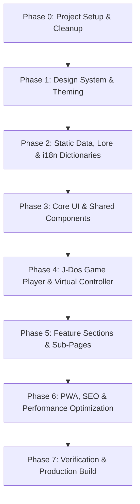

# 🚀 Atomic Implementation Plan — Tyrian DOS Game (Next.js 16 + J-Dos)

> **Dokumen Perencanaan Tingkat Atomik (Atomic Plan)**  
> Sesuai standar **Amir App / Next.js 16 (React 19)**, **Tailwind CSS v4**, **Serwist PWA**, **i18n**, dan **J-Dos Emulation Engine**.

---

## 📌 Ringkasan Proyek

| Item | Deskripsi |
| --- | --- |
| **Nama Website** | **Tyrian — Retro DOS Arcade** |
| **Framework** | Next.js 16.3.0 (App Router, React 19) |
| **Bahasa** | TypeScript 6.0.3 (Strict Mode) |
| **Styling** | Tailwind CSS v4.3.3 + Custom Arcade/CRT Scanline Theme |
| **Game Engine** | J-Dos (DOSBox WebAssembly Player) + Tyrian 2.1 DOS Game Bundle |
| **Source Reference**| OpenTyrian (C / SDL open-source port) |
| **PWA** | Serwist v9.5.12 |
| **i18n** | Cookie-based (`id` default, `en`) |

---

## 🗺️ Tahapan Pengerjaan Atomik (Atomic Phases)

---

### 📦 Phase 0: Project Setup & Cleanup
- [x] **0.1** Verifikasi `GUIDELINE.md` dan `AGENTS.md`.
- [x] **0.2** Hapus rute demo `src/app/demo-encryption/` sesuai aturan **Guideline #13** agar tidak masuk build produksi.
- [x] **0.3** Siapkan aset DOS game bundle Tyrian (`tyrian.zip` / `tyrian21.zip`) dan library J-Dos runtime.
- [x] **0.4** Siapkan dokumentasi & metadata OpenTyrian source code (`https://github.com/opentyrian/opentyrian`) langsung di root direktori `/opentyrian`.

---

### 🎨 Phase 1: Design System & Theming (Tailwind CSS v4)
- [x] **1.1** Modifikasi `src/app/globals.css` untuk mendaftarkan Retro Arcade Sci-Fi Design Tokens:
  - Neon Cyan (`#00f0ff`), Plasma Violet (`#8b5cf6`), Amber Warning (`#f59e0b`), Deep Space (`#050811`), CRT Green (`#22c55e`), Hull Grey (`#1e293b`).
  - Scanlines effect & CRT Flicker CSS keyframe animations.
  - Glow utility classes (`drop-shadow-neon`, `box-shadow-arcade`).
- [x] **1.2** Konfigurasi `@theme inline` untuk typography gaming/arcade dan font Geist.
- [x] **1.3** Pastikan Dark Mode dan Light Mode kompatibel secara mulus.

---

### 📄 Phase 2: Static Data, Lore & i18n Dictionaries
- [x] **2.1** Buat data dummy JSON di `src/data/`:
  - `ships.json` — Informasi armada kapal tempur Tyrian, statistik armor, shield, generator, power, speed, special ability.
  - `weapons.json` — Katalog persenjataan Front, Rear, dan Sidekicks dengan damage rating & power cost.
  - `episodes.json` — 5 Episode cerita Tyrian (Escape, Treachery, Mission: Suicide, An End to Fate, Hazel's Story).
  - `soundtrack.json` — Tracklist Alexander Brandon OST dengan deskripsi, BPM & durasi.
  - `leaderboard.json` — Dummy high score arcade table dengan pilot rankings.
  - `opentyrian-repo.json` — Ringkasan source code repository OpenTyrian (arsitektur C, SDL, build instructions).
- [x] **2.2** Update `src/dictionaries/id.json` & `src/dictionaries/en.json`:
  - Terjemahan lengkap bilingual untuk navigasi, deskripsi game, instruksi kontrol, panduan senjata, dan footer.

---

### 🧩 Phase 3: Core UI & Shared Components
- [x] **3.1** `src/app/_components/header.tsx` — Retro arcade navbar dengan logo animasi, status system online, navigasi menu, dan quick play CTA.
- [x] **3.2** `src/app/_components/footer.tsx` — Arcade cabinet footer dengan credit Epic MegaGames, Alexander Brandon, OpenTyrian project, dan status PWA.
- [x] **3.3** `src/app/_components/ui/` — Komponen UI modular:
  - `arcade-button.tsx` — Tombol gaya retro dengan tactile sound/hover effect & glow.
  - `arcade-card.tsx` — Kontainer berbingkai sci-fi / HUD corner brackets.
  - `crt-screen-frame.tsx` — Frame monitor tabung dengan opsional scanlines & curvature.
  - `badge.tsx` — Status badge (DOS, 60 FPS, WebAssembly, v2.1).
- [x] **3.4** Pertahankan `LanguageSwitcher` dan `ThemeSwitcher` (hidden by default sesuai guideline).

---

### 🕹️ Phase 4: J-Dos Game Player & Virtual Controller
- [x] **4.1** `src/app/_components/game/jdos-player.tsx`:
  - Client component (`"use client"`) dengan lazy loading js-dos / DOSBox runtime.
  - Memuat canvas game Tyrian 2.1 dengan tombol "LAUNCH GAME".
  - Tombol kontrol audio, toggle fullscreen, restart game, dan status FPS.
- [x] **4.2** `src/app/_components/game/virtual-gamepad.tsx`:
  - Touch control on-screen untuk perangkat mobile / tablet (D-Pad, Fire Button, Space Missile, Weapon Switch, Esc Menu).
- [x] **4.3** `src/app/_components/game/controls-guide.tsx`:
  - Panduan tombol keyboard fisik (Arrow keys, Space, Ctrl, Alt, Enter, Esc).

---

### 🚀 Phase 5: Feature Sections & Sub-Pages
- [x] **5.1** **Homepage (`src/app/page.tsx`)**:
  - **Hero Section**: Judul Tyrian retro berkilau, status arcade, quick launch.
  - **Game Arena Section**: J-Dos Player interaktif dengan CRT bezel frame.
  - **Ship Hangar & Loadout Section**: Showcase interaktif pesawat & persenjataan.
  - **Weapons Catalog Section**: Katalog interaktif Front Gun, Rear Gun, dan Sidekicks.
  - **Episodes Section**: Showcase 5 episode petualangan Tyrian.
  - **OST Jukebox Section**: Pemutar audio soundtrack Alexander Brandon chiptune player dengan waveform visualizer.
  - **High Scores / Hall of Fame**: Tabel arcade leaderboard dengan filter episode & difficulty.
  - **Story & Universe Lore**: Kisah Trent Hawkins, korporasi MicroSol, dan mineral Zinglon.
- [x] **5.2** **OpenTyrian Source Code Showcase (`src/app/source/page.tsx`)**:
  - Halaman khusus dokumentasi dan eksplorasi source code OpenTyrian (arsitektur C, SDL2, Makefile, integrasi port).
  - Link langsung ke repository GitHub `opentyrian/opentyrian`.
- [x] **5.3** **Pilot Manual & Cheats (`src/app/manual/page.tsx`)**:
  - Panduan gameplay, rahasia minigame DESTRUCT, trik upgrade ship, dan cheat codes legendaris.

---

### ⚡ Phase 6: PWA, SEO & Performance Optimization
- [x] **6.1** Update `src/app/manifest.ts` dengan metadata Tyrian Retro Arcade.
- [x] **6.2** Update `src/app/robots.ts` dan `src/app/sitemap.ts`.
- [x] **6.3** Tambahkan JSON-LD Structured Data (`VideoGame`, `WebSite`, `Organization`).
- [x] **6.4** Optimasi asset gambar dan lazy loading component game.

---

### ✅ Phase 7: Verification & Production Build
- [x] **7.1** `bun run lint` — 0 errors & 0 warnings.
- [x] **7.2** `bun run build` — Berhasil terkompilasi dalam 29.9s (Next.js 16 + React 19 + Serwist PWA).
- [x] **7.3** Verifikasi responsivitas UI desktop & mobile.
